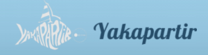

+++
title = "Useful links"
slug = "useful-links"
+++

## Sailing

Would you like to take to the sea while you're in the Charente-Maritime — whether for a leisurely day out with friends or to sharpen your sailing skills?

We recommend the two sailing schools below. We learned with them ourselves, and they're absolutely top-notch! 😉

## Bike hire

In Saint-Martin-de-Ré, hire your bikes from Yootoo. Excellent quality, lovingly maintained — and those stylish black bikes with white polka dots are quite a sight!

