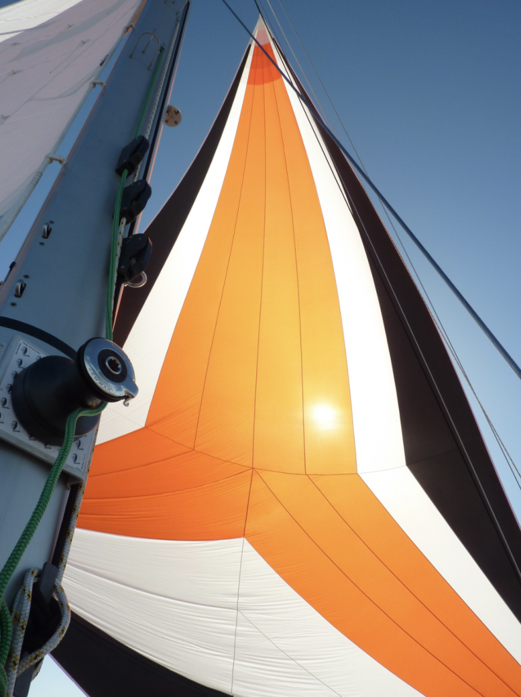

+++
title = "Liens utiles"
+++

## Navigation à la voile

Vous souhaitez profiter de votre présence en Charente Maritime pour naviguer à la voile, que ce soit pour une balade entre amis ou pour vous perfectionner.

Nous vous recommandons les deux écoles de croisière suivantes. Nous avons appris avec eux, ils sont au taquet ! 😉

## Location de vélo

A Saint Martin de Ré, louez vos vélos chez Yootoo. Vous aurez des vélos de très bonne qualité et entretenus avec soin. Et puis quel look ces vélos noirs à pois blancs !

